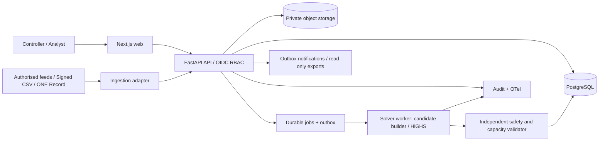

# 04 — Architecture and Technology Decisions

## Stack — intentionally small and production-capable
- **Web:** Next.js App Router + TypeScript + React; server-rendered shell and client-side interactive planning. TanStack Query for validated backend state, Zustand only for transient UI controls if needed, Tailwind or typed CSS tokens, accessible component library, ECharts/visx/Apache ECharts for analytical views.
- **API:** Python FastAPI + Pydantic 2 + SQLAlchemy 2 + Alembic; OpenAPI 3.1 contract; stateless app replicas. Python aligns with optimisation and the existing claimed prototype approach.
- **Solver:** Python **HiGHS/highspy MILP** in isolated worker processes for Recover and first Protect production version; compatibility adapter can support OR-Tools CP-SAT later **only** if benchmark/test gates justify migration. Never mix silent integer scaling between solvers.
- **Storage:** PostgreSQL for canonical data, tenant scoping, state transitions, outbox and versioned rules; S3-compatible private object storage for import artifacts and evidence exports. Redis for queue/cache only, never as canonical decision store. Use a durable task queue with DB-backed job/outbox semantics; evaluate Dramatiq+Redis or Celery but wrap the broker so an expired message cannot lose the job record.
- **Auth:** standards-based enterprise OIDC provider for browser login; backend validates issuer, audience, expiry and key rotation; server-side session and role mapping. No in-house password system in production.
- **Observability:** OpenTelemetry traces/metrics, structured logs, Sentry-compatible error sink, explicit PII redaction, operational dashboards.
- **Infrastructure:** Docker images, managed Postgres, managed Redis, private object storage, reverse proxy with TLS, IaC via Terraform/Pulumi after host chosen. Deploy Next.js as a Node/Docker server, not static export.
- **CI:** GitHub Actions or equivalent; typecheck, lint, migrations, API/solver tests, Playwright, dependency and container scan, SBOM, staging deploy, promotion gate.

## Architecture diagram


## Why this design
Modular monolith + separate worker is simpler to deliver and audit than premature microservices. Domain modules have explicit interfaces so Optimizer, connectors and UI can evolve independently. HTTP requests never run a large MILP; every solve references immutable validated input. No connector gets implicit authority to perform irreversible operational actions.

## Repository layout
```text
cargopulse/
  apps/web/                 # Next.js, routes, chart rendering, UI tests
  services/api/             # FastAPI app, migrations, contracts, auth
  services/worker/          # job executor + constraints + solver adapter
  packages/contracts/      # generated TypeScript types / OpenAPI spec
  packages/domain-fixtures/ # synthetic fixture schemas and seeds
  infra/                   # docker compose, IaC, runbooks
  docs/                    # ADRs, schema evolution, policies, privacy
  tests/                   # contract, cross-service, replay, safety
```

## Important bounded contexts
1. **Identity/Tenant**: role grants and access control.
2. **Cargo Operations**: AWBs, pieces, ULDs, shipments, flights, routing, capacity snapshots.
3. **Event & Snapshot**: immutable disruption event and decision point; source freshness.
4. **Rules & Feasibility**: policy revision and signed operational constraints; reason codes.
5. **Optimisation & Validation**: candidate graph, solver statuses, independently evaluated assignments.
6. **Human Decisions**: plans, approvals, supersession, frozen windows.
7. **Replay/Evidence**: paired baselines, synthetic/historical provenance, metrics.
8. **Connectors**: provider-specific mapping into internal canonical model; no business logic in adapters.

## Critical sequence
```mermaid
sequenceDiagram
  participant User as Controller
  participant API
  participant DB
  participant Queue
  participant Solver
  participant Validator
  User->>API: POST /scenarios/{id}/solve (snapshot version)
  API->>DB: check policy, lock input snapshot, create job+outbox
  API-->>User: 202 Accepted {job_id}
  Queue->>Solver: claim durable job
  Solver->>DB: load immutable snapshot and policy revision
  Solver->>Solver: generate hard-feasible candidate arcs
  Solver->>Solver: solve bounded MILP / fallback
  Solver->>Validator: independent constraint check
  Validator-->>Solver: pass or exact violations
  Solver->>DB: persist plan, telemetry, validation, artifacts
  User->>API: GET /jobs/{id}, GET /plans/{id}
  API-->>User: status, snapshot, proposed changes, explanations
  User->>API: POST /plans/{id}/decisions with If-Match
  API->>DB: check freshness + permissions + validator + audit transaction
  API-->>User: approved in-app decision; no external write
```

## Consistency and operation
- Database stores job before any broker dispatch; transactional outbox sends message with at-least-once delivery. Worker uses unique job ID, lease and idempotent terminal write. Duplicate messages must never create duplicate approved plans.
- Input events have source_time, ingest_time and monotonic `version`. Plans reference snapshot hash; no mutable in-place changes.
- Cache may speed reads but never determine safety; transaction isolation and version checks determine approvals.
- For concurrent solves, only `PLAN_READY` for a matching current scenario can be submitted for approval; stale answers persist for audit but carry `STALE`.
- Tenant boundaries extend into object storage prefixes, query filters, async jobs, SSE and metrics tags.
- All user-visible timings use configured airport timezone while storing ISO UTC. Never infer transport connections based on simplistic date-only rules.

## ADRs to write immediately
ADR-001 modular monolith + solver worker, ADR-002 HiGHS as initial MIP, ADR-003 OIDC identity, ADR-004 read-only external integration, ADR-005 canonical AWB/ULD associations, ADR-006 policy versioning, ADR-007 chosen hosting/region and data retention.
